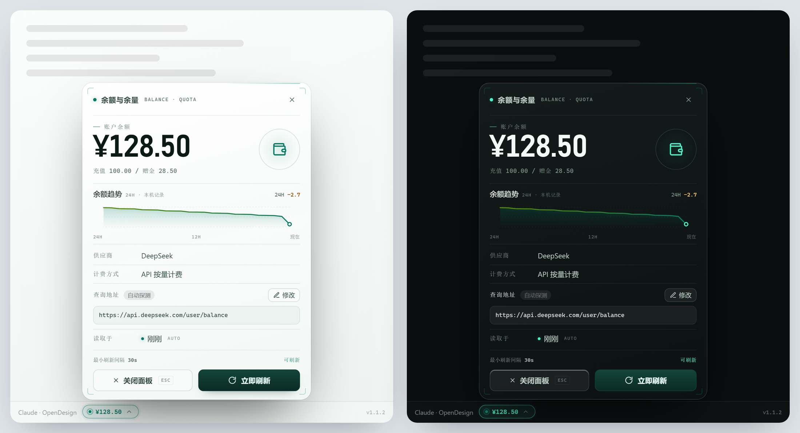
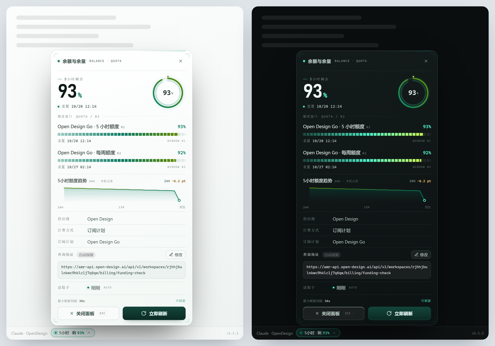
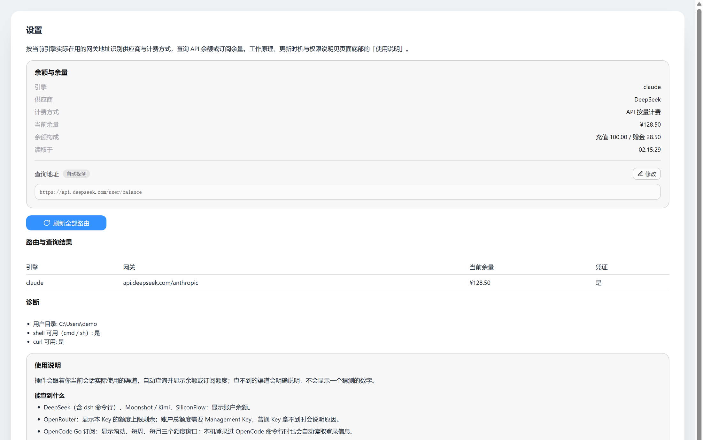

# balance-meter（余额与余量）

CC GUI 插件：**按当前引擎实际在用的网关地址识别供应商与计费方式**，查询并显示对应的 API 余额或订阅余量。

- **按量计费**的供应商 → 显示账户余额
- **订阅计划** → 显示各额度窗口的剩余百分比与重置时间
- 供应商没有可用的查询接口 → 明确说明查不到，不显示猜测的数字

## 功能

- **状态栏 chip**：随时看到当前渠道的余量。订阅渠道显示最短的额度窗口（如「5小时 98%」），
  按量渠道显示余额金额；查不到时显示「无法查询」。
- **详情面板**：供应商、计费方式、订阅计划、各额度窗口、查询地址与最近查询时间，可手动刷新。
- **设置页**：当前路由详情、查询地址可手工修改、全部路由清单与诊断信息。
- **自动刷新**：打开 CC GUI、切换标签 / 会话 / 引擎、每轮对话结束后自动更新。
- **渠道识别**：自动读取 CC GUI 的自定义渠道，以及 claude、codex、kimi、grok、dsh、opencode
  等引擎的本地登录信息，不需要手工配置。

## 安装

- **插件市场**：CC GUI → 设置 → 插件 → 插件市场 → 搜索「余额与余量」→ 安装。
- **本地安装**：先构建产物，再 CC GUI → 设置 → 插件 → 从本地目录安装，选择 `dist/` 目录
  （不是仓库根目录，宿主需要 `main.js` 与 `manifest.json` 位于同一层）。

## 界面

状态栏面板：按当前路由显示 API 余额或订阅余量（左浅色 / 右深色）。



订阅渠道按窗口展示额度。



设置页：当前路由详情、查询地址（可手工修改）、路由清单与诊断。



> 以上为界面示意，数字为示例数据。

## 什么时候会更新

| 时机 | 行为 |
|---|---|
| 打开 CC GUI | 对准上次使用的引擎（或当前会话），立即查询一次 |
| 切换标签 / 选择会话 | 切到该引擎的路由，重新查询 |
| 每轮对话结束 | 自动刷新一次（两次自动刷新之间至少间隔 30 秒，可在设置中调整） |
| 手动 | 状态栏面板「立即刷新」、设置页「刷新全部路由」、命令面板「刷新余额与余量」 |

查询成功的接口会按路由（域名 + 路径）缓存，下次直接命中；缓存地址失效时自动重新探测。
全部探测失败后 10 分钟内不再重复请求，手动刷新可强制重探。

## 支持的供应商

| 供应商 | 网关域名 | 计费 | 能查到什么 |
|---|---|---|---|
| DeepSeek | api.deepseek.com | 按量 | 账户余额（含 dsh 命令行读到的 API Key） |
| OpenRouter | openrouter.ai | 按量 | 本 Key 的额度上限与剩余；账户总额度需要 Management Key |
| Moonshot / Kimi | api.moonshot.cn / .ai | 按量 | 账户余额 |
| SiliconFlow | *.siliconflow.cn / .com | 按量 | 账户余额 |
| OpenAI（官方直连） | api.openai.com | 按量 | 账单额度（部分账号不可用） |
| 智谱 GLM / Z.AI 编码套餐 | open.bigmodel.cn · api.z.ai | 订阅 | 5 小时 / 每周额度 |
| Kimi Coding | api.kimi.com | 订阅 | 5 小时 / 每周额度（API Key 或 Kimi Code CLI 登录） |
| MiniMax 编程套餐 | api.minimaxi.com · api.minimax.io · api.minimax.chat | 订阅 | 5 小时 / 每周额度 |
| OpenCode Go | opencode.ai/zen/go | 订阅 | 滚动 / 每周 / 每月额度（API Key 或 OpenCode CLI 登录） |
| Open Design（AMR / Vela） | amr-link.open-design.ai · *.powerformer.net | 订阅 / 按量 | 有订阅：5 小时 / 每周额度；无订阅：账户可用余额（需安装并登录 Open Design 客户端） |
| OpenAI 订阅 | chatgpt.com | 订阅 | 5 小时 / 每周额度（Codex 使用 ChatGPT 账号登录时） |
| Claude 订阅 | api.anthropic.com | 订阅 | 5 小时 / 7 天额度（Claude Code 使用订阅账号登录时，实验性） |
| Grok 订阅 | cli-chat-proxy.grok.com | 订阅 | 当前计费周期的额度（Grok CLI 登录时） |
| 常见中转站 | 任意其它域名 | 按返回值推断 | 依次尝试常见接口，部分站点可显示 5 小时 / 每日 / 每周窗口 |

以下供应商没有公开的余额或余量接口，插件会直接说明原因：OpenCode Zen（按量）、Anthropic 官方、
Z.AI 编码套餐、Xiaomi MiMo 及其 Token Plan、阿里云百炼、LongCat、xAI Grok、Groq、Mistral、
Together、Google Gemini。

### 中转站探测顺序

未识别的域名会依次尝试下列接口（均只使用站点发给用户的 API Key）：

1. `GET /api/usage/token/`（New-API，一次请求直出剩余额度）
2. `GET /v1/dashboard/billing/subscription` + `/usage`（剩余 = 总额度 − 已用）
3. `GET /v1/usage`（Sub2API 系，可带 5 小时 / 每日 / 每周窗口）
4. `GET /api/v1/me/quota`（claude-code-hub）
5. `GET /dashboard/billing/credit_grants`（CloseAI 系）
6. `GET /api/v1/credits`
7. `GET /api/user/self`（仅个别变体支持）

前两条会先读取站点的 `/api/status`，按站点自己声明的记账单位换算，避免金额数量级出错。

### 自定义查询地址

如果服务商有查询接口但不在上表中，可在插件设置里为该路由填写「查询地址」，保存后立即生效。
地址支持 `{base}`（完整网关地址）与 `{origin}`（协议 + 域名）占位符，查询时使用该路由的 API Key。
留空即恢复自动探测。

## 权限与隐私

插件声明了 `exec:curl`，以及 `exec:cmd` / `exec:powershell.exe`（Windows）、`exec:sh`（macOS、Linux）：

- 宿主的网络出口要求预先声明域名，而按实际路由识别渠道无法预知域名，因此网络请求通过系统自带的
  `curl` 完成；
- `cmd` / `sh` 只用于获取用户目录；
- `curl` 读取本机各 AI 工具的配置与登录信息，并向**当前路由对应的供应商**发起只读查询；
- Codex 的 ChatGPT 订阅额度通过本机 `codex app-server` 查询；
- **不读取 CC GUI 的内部状态**：当前引擎只来自官方事件（`session://activated` 与 usage 载荷）；
- 凭证只用于上述只读查询，不写入插件存储、不写日志、不发送给任何第三方；
- 登录过期时只提示重新登录，不会替用户刷新凭证（避免破坏原有登录态）。

读取的本地文件：

| 文件 | 用途 |
|---|---|
| `~/.ccgui-next/config.json` | CC GUI 的自定义渠道与当前渠道 |
| `~/.claude/settings.json`、`~/.claude/.credentials.json` | Claude 的网关与订阅登录 |
| `~/.codex/config.toml`、`~/.codex/auth.json` | Codex 的网关与登录 |
| `~/.kimi-code/credentials/kimi-code.json` | Kimi Code CLI 登录 |
| `~/.grok/auth.json` | Grok CLI 登录 |
| `~/.dsh/.credentials.yaml` | DeepSeek Harness 的 API Key |
| `~/.local/share/opencode/auth.json` | OpenCode 登录 |
| `~/.amr/config.json` | Open Design 客户端登录 |

## 适用平台

- **Windows**：支持。
- **macOS / Linux**：已适配，尚未在真机上验证；若路径或命令行为有差异，可反馈。

当前会话的即时识别依赖较新版本的 CC GUI；旧版本可能在切换一次标签或发送一条消息后才显示正确。

## 已知限制

- 订阅类渠道的额度窗口由各家服务商定义，没有窗口数据时不会显示。
- 中转站接口差异很大；探测失败时可用「查询地址」手工指定。
- 中转站对额度耗尽的令牌常直接返回 401，此时显示为查询失败而不是 0。
- New-API 的订阅制额度需要面板访问令牌，站点发给用户的 API Key 无法查询。
- xAI 的团队余额在 Management API 中，需要额外的 management key 与 team id，插件不自动读取。
- Open Design 的余额属于账户，需要本机安装并登录 Open Design 客户端；渠道里配置的网关 Key
  只能用于模型推理，不能查询账单。
- pi / omp / qoder / agy 引擎暂未接入：凭证格式或登录方式暂不适合只读查询。

## 更新记录

### 0.3.0

- 新增 Open Design（AMR / Vela）渠道：有订阅时显示 5 小时 / 每周额度，无订阅时显示账户可用余额。
- 订阅渠道的状态栏改为显示最短额度窗口（如「5小时 98%」），面板不再重复显示总额。

### 0.2.2

- 扩大常见中转站的支持范围，按实际可用的接口顺序探测，并按站点声明的记账单位换算。
- 修正 OpenRouter、MiniMax、SiliconFlow、Moonshot 的取值与币种问题。
- 新增 dsh 与 OpenCode 引擎的本地登录识别。
- 更正各渠道「查不到」的提示文案。

### 0.2.1

- 市场展示素材（图标与效果图）；点击面板外部可关闭面板。

### 0.2.0

- 支持订阅类渠道的额度查询：ChatGPT、Claude、OpenCode Go、Kimi For Coding、
  智谱 GLM / Z.AI、MiniMax、Grok。

## 开发

```bash
pnpm install
pnpm typecheck && pnpm test          # 类型检查与单元测试
pnpm build                           # 构建到 dist/（可用 CCGUI_PLUGIN_OUT_DIR 覆盖）
pnpm validate && pnpm validate:dist  # 本地预检，镜像市场 CI 的门槛
```

本地调试：`pnpm build` 后从 `dist/` 目录安装；修改代码后重新构建并再次安装即可（宿主会热加载）。

发版：更新 `manifest.json` 的 `version`，然后 `git tag <version> && git push origin <version>`。
仓库的 GitHub Action 会构建并把 `main.js` / `manifest.json` / `checksums.txt` 附到 Release。

展示素材由 manifest 的 `icon` / `screenshots` 声明，市场按仓库默认分支读取；图标源文件为
`docs/icon.svg`。

## License

MIT，见 [LICENSE](LICENSE)。
